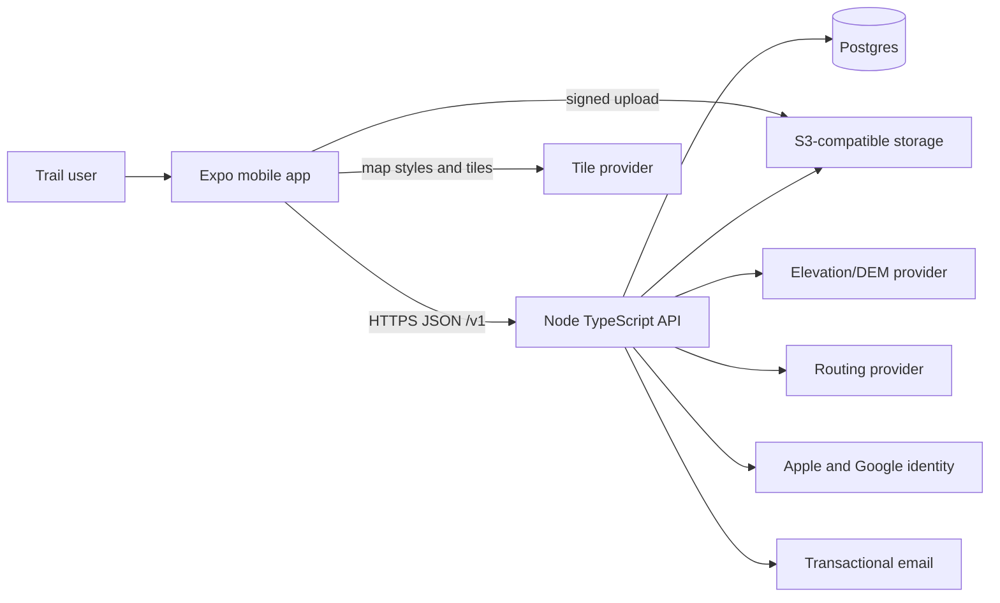
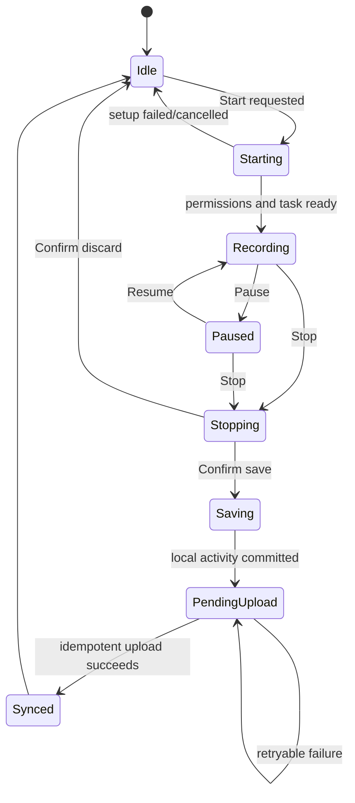

# Trail v1 Architecture

**Status:** Target architecture for implementation  
**Derived from:** `PRD.md` v1.0, dated 2026-08-21  
**Scope:** iOS and Android mobile application, REST API, relational data, object storage, and external map/geo services

## 1. Architectural goals

Trail must optimize for one critical promise: a user can record an outdoor activity without babysitting the phone and without losing it when connectivity or the app process fails. The architecture therefore prioritizes:

1. Durable, offline-first GPS recording.
2. Idempotent synchronization with no duplicate activities.
3. Owner-private GPS and photo data.
4. Consistent calculations across mobile and server.
5. Replaceable map, routing, elevation, email, and storage providers.
6. A small production-shaped system that can ship to TestFlight and Play internal testing without premature microservices.

## 2. Context and boundaries



The mobile app is trusted to collect data but is not trusted for identity, ownership, or authorization. Postgres is the source of truth for synchronized records. The local database is the source of truth only for an active recording and pending synchronization.

## 3. Target repository organization

```text
apps/
  mobile/
    app/ or src/navigation/    routes, tabs, stacks
    src/features/              auth, record, activities, routes, stats, profile
    src/services/              API, location, secure storage, connectivity
    src/storage/               local database and migrations
    src/state/                 feature state and recording coordinator
  api/
    src/modules/               auth, users, activities, photos, routes, stats
    src/http/                  server, middleware, errors, request context
    src/providers/             object storage, identity, email, elevation, routing
    src/db/                    schema, migrations, repositories
packages/
  contracts/                   schemas, DTOs, error codes, enums
  domain/                      pure calculations and recording rules
  config/                      shared tooling configuration
infra/                         local compose and deployment definitions
```

This is a target, not current repository state. Bootstrap uses **Node.js 22** and **pnpm workspaces**. The mobile app targets **Expo SDK 57** and the React Native version selected by that Expo SDK; do not pin or upgrade React Native independently. The API is a **Fastify** modular monolith. **Zod** is the single boundary-validation system for shared contracts and environment variables, **Drizzle ORM** owns the Postgres schema and migrations, and **Vitest** is the unit/integration test runner. **ESLint** and **Prettier** are required workspace checks.

## 4. Mobile architecture

### 4.1 Feature boundaries

- **Auth:** onboarding, email and SSO, secure session lifecycle.
- **Record:** permissions, GPS lock, state machine, background task, HUD, live map, crash recovery.
- **Activities:** pending uploads, list, detail, edit/delete, splits, elevation, photos.
- **Routes:** list, waypoint editor, route detail, route-to-record handoff.
- **Stats/You:** week/year aggregation, calendar, profile, units, settings, legal.
- **Platform services:** location, background tasks, notifications, camera/library, connectivity, secure storage.

UI components consume feature services; they must not directly implement filtering, persistence, token refresh, or synchronization.

### 4.2 Recording state machine



An active session has a client UUID before the first point. The state, timestamps, sport, optional route ID, and filtered points are committed locally at least every five seconds or every configured batch. Pause writes state immediately. Discard requires confirmation and removes only the selected local session. A process restart discovers an active `recording` or `paused` session and offers resume.

The maximum elapsed duration is 12 hours. At the limit, the app stops collection and presents save. Save is allowed when elapsed duration is at least 30 seconds **or** filtered distance is at least 50 metres.

### 4.3 Location pipeline

```text
OS location sample
  -> validate coordinates/timestamp
  -> classify horizontal accuracy
  -> reject impossible sport-specific jumps
  -> append accepted point to durable session
  -> update distance/HUD/polyline
  -> periodically checkpoint session
```

Target foreground sampling is 1 Hz while moving. Prefer accuracy at or below 20 m; reject or down-weight samples above 50 m unless no better fix exists. Sustained speed caps are 12 m/s for run/walk/hike and 30 m/s for ride. Distance is the sum of filtered consecutive geodesic segments. Elevation gain is never the sum of raw GPS altitude changes; use smoothed GPS as fallback and DEM-derived elevation when available.

### 4.4 Local persistence and sync

Use SQLite rather than a single JSON file because sessions, point batches, pending mutations, and photo uploads require transactional updates and indexed retries.

Minimum local records:

- `recording_sessions`: UUID, state, sport, route ID, timestamps, last sequence, computed preview stats.
- `recording_points`: session UUID, sequence, latitude, longitude, elevation, accuracy, recorded time.
- `sync_jobs`: stable operation ID, entity ID, operation, attempt count, next attempt, last safe error code.
- `pending_photos`: local URI, activity ID, state, metadata, upload attempt data.

Sync runs after local save, app foreground, authentication refresh, connectivity restoration, and persisted retry deadlines. Use exponential backoff with jitter and bounded retries before requiring user action. A 401 triggers one coordinated token refresh and request replay. The UI distinguishes `saving locally`, `waiting to upload`, `uploading`, `synced`, and `needs attention`. Local source points, pauses, session, and job are retained through timeout/unknown-commit states; after a confirmed canonical server response they are deleted together in one SQLite transaction rather than retaining an unbounded local synced copy.

### 4.5 Platform behavior

- **iOS:** background location mode, accurate purpose strings, staged When In Use/background permission education, and real-device locked-screen tests.
- **Android:** API 26+, location foreground service, persistent elapsed/distance notification, Android 13+ notification permission, and best-effort OEM battery guidance.
- Tokens live only in Keychain/EncryptedSharedPreferences through secure storage.
- Map tile caches are SDK-managed; downloadable offline regions are outside v1.

## 5. API architecture

### 5.1 Shape

Use a modular monolith exposing JSON REST under `/v1`. Each module owns HTTP handlers, application services, repositories, schemas, and tests. Cross-cutting middleware provides request IDs, authentication, authorization context, rate limiting, validation, structured logs, and consistent errors.

All failures use:

```json
{
  "error": {
    "code": "stable_machine_code",
    "message": "Safe user-facing summary"
  }
}
```

Validation errors may include field details that contain no secrets. Domain errors map predictably to HTTP status codes. Unknown exceptions return a generic message and are captured server-side.

### 5.2 Resource surface

| Area       | Endpoints                                                                      |
| ---------- | ------------------------------------------------------------------------------ |
| Auth       | `POST /v1/auth/register`, `/login`, `/refresh`, `/logout`, `/apple`, `/google` |
| User       | `GET/PATCH/DELETE /v1/me`                                                      |
| Activities | `GET/POST /v1/activities`, `GET/PATCH/DELETE /v1/activities/:id`               |
| Photos     | signed upload initiation and completion/delete endpoints scoped to an activity |
| Routes     | `GET/POST /v1/routes`, `GET/PATCH/DELETE /v1/routes/:id`                       |
| Stats      | read-only week, year, and calendar queries, or activity query projections      |

List endpoints use cursor pagination with deterministic ordering. Every resource query includes `user_id` from the authenticated principal. Do not accept a user ID from clients as authorization input.

### 5.3 Authentication

- Passwords are at least eight characters and use the maintained native `@node-rs/argon2` Argon2id implementation with 64 MiB memory, three iterations, one lane, and bounded process concurrency/queueing.
- Access JWTs live for **15 minutes**, carry `auth_version`, use only HS256, and require exact issuer/audience. `JWT_SIGNING_KEY` is exactly 32 random bytes encoded as base64url. Rotation deploys a verification overlap before changing the active signer; the current single-key implementation requires coordinated session invalidation when replaced.
- Refresh tokens expire after **30 days**, are opaque, random, SHA-256 hashed at rest, device-family scoped, and rotated. A client-stable `rotation_request_id` maps the consumed predecessor to its AES-256-GCM-encrypted successor. Same-ID recovery remains available while that successor is unconsumed, unexpired, and unrevoked; consuming the successor clears predecessor recovery fields transactionally. Any different-ID old-token use revokes the family. Expired/revoked successor cleanup also clears recovery fields.
- `REFRESH_RECOVERY_KEY` is a distinct 32-byte key. It must remain available while any encrypted successor row exists; key retirement requires draining/clearing those rows or a versioned re-encryption migration. No plaintext successor is stored.
- Logout increments `auth_version` only when it newly revokes an active family, making replay idempotent. Password reset increments `auth_version`; middleware checks the current database version so prior access JWTs fail immediately.
- Password-reset requests perform one foreground database statement for known and unknown accounts and enqueue encrypted delivery/tombstone work. `EMAIL_OUTBOX_KEY` encrypts recipient/token payloads with AES-256-GCM; the worker retries at most five times. Email contains a pasteable token, not a URL. Confirmation returns documented `204 No Content`. Outbox-key retirement must wait for the 24-hour delivered/dead purge or use versioned re-encryption; unknown tombstones are deleted immediately when processed.
- Registration is email-verified and non-enumerating: initial requests always return identical `202 accepted`; new addresses store only normalized email, Argon2id hash, display name, and a hashed one-use verification token, while existing addresses perform encrypted tombstone work. `/v1/auth/register/confirm` atomically creates the user/password identity and session and never overwrites an existing account.
- Auth endpoints apply independent validated-IP and normalized identity/token-hash limits, plus bounded global and endpoint Argon2 queues. Koyeb production trusts exactly the configured proxy hop count. All limiter state is process-local for the single free instance and must move to a shared bounded store before horizontal scaling.
- Apple/Google JOSE/JWKS verifier interfaces remain non-routable. Sign-in and linking routes are intentionally absent even when client IDs exist until server-owned one-use state, nonce, PKCE, native callback setup, real provider evidence, and recent step-up for linking are implemented. Canonical issuers/JWKS are pinned and multi-audience tokens require matching `azp`.
- Account deletion requires current password proof and conditional deletion against the authenticated `auth_version` and observed password hash. Wrong proof is stable `403 step_up_failed`; independent per-IP and per-user attempt limits apply. SSO-only deletion is blocked with `step_up_required` until provider step-up exists.

### 5.4 Activity ingestion

`POST /v1/activities` uses the client-generated activity UUID as the resource ID and an idempotency key. Repeating an identical request returns the existing resource. Reusing the UUID with conflicting immutable data returns `409 conflict`.

The server validates timestamps, point order, supported sport, maximum duration, coordinate ranges, ownership of any route ID, and a hard maximum of **100,000 filtered points per activity**. The client must reject an over-limit save with a recoverable/exportable local state rather than silently truncate; server requests over the limit fail with a stable `413` error. Canonical stats are recomputed from filtered points; the API does not blindly trust client totals. The write transaction creates the activity, points, split data, and initial elevation-processing state together.

## 6. Data architecture

Use Postgres UUIDs and `timestamptz`. Store instants in UTC. Store distance/elevation in metres and duration in seconds. Presentation derives pace, speed, and user units.

### 6.1 Core tables

- `users`: email, password hash, display name, avatar, units, default sport, auth version, timestamps.
- `auth_identities`: provider, provider subject, user ID; unique by provider/subject. Provider writes are blocked while SSO/linking is non-routable.
- `refresh_tokens`: token hash, family, expiry/revocation, rotation-request hash, successor-token relation, and AES-GCM encrypted successor recovery fields.
- `registration_verifications`: normalized email, Argon2id password hash, display name, one-use verification-token hash, expiry/consumption.
- `password_reset_tokens` and `email_outbox`: one-use token hashes plus encrypted bounded-retry registration/reset delivery and tombstone work. Tombstones are deleted when processed; delivered/dead rows and expired token records are purged after 24 hours.
- `activities`: owner, sport, title/notes, UTC bounds, canonical totals, overview polyline, optional route, timestamps.
- `activity_points`: activity, sequence, coordinates, elevation, timestamp, accuracy; unique `(activity_id, seq)`.
- `activity_splits`: activity, unit system/distance boundary, index, distance, duration.
- `activity_elevation_samples`: activity, position/time and smoothed/DEM elevation, or a documented compact JSON representation.
- `routes`: owner, name, sport hint, waypoints, polyline, canonical distance/elevation, timestamps.
- `activity_photos`: activity, private object key, dimensions, optional location/capture time, sort order.

Selected track design: **overview polyline plus filtered points table**. The accepted filtered stream is retained for the life of the activity in v1; there is no time-based point downsampling or deletion policy. Display polylines may be derived/downsampled without altering retained source points. Revisit retention only through a documented post-v1 privacy/storage decision.

### 6.2 Constraints and indexes

- Unique normalized email where present.
- Unique `(provider, provider_subject)`.
- Unique `(activity_id, seq)` and `(user_id, activity_client_id)` if client ID is separate.
- Index activities and routes by `(user_id, started_at/created_at DESC)`.
- Foreign keys cascade for account/activity deletion where safe; object deletion uses an asynchronous outbox because Postgres cannot atomically remove blobs.
- Check constraints enforce supported sports, units, positive canonical metrics, and coordinate ranges.

Stats query saved server activities only. Unsynced local activities are excluded and the mobile app shows a pending-sync banner. Start-of-week follows the requesting device locale; API queries receive an explicit timezone and week boundary, validate them, and return UTC instants.

## 7. Photos and object storage

Photos are private, limited to **ten per activity** and **10 MB per input image**, and validated by content rather than extension. The client requests a signed upload valid for **15 minutes**, uploads directly to S3-compatible storage, then completes the record with the API. The server verifies object existence, content type, and byte size before marking it ready; normalized output limits and dimensions must be documented during implementation.

Normalize supported JPEG/HEIC/WebP inputs, strip EXIF, and separately retain only explicitly needed capture time/location. Downloads use short-lived signed URLs. Deletion removes the database reference transactionally and queues idempotent blob deletion through an outbox/retry worker. Account deletion performs the same cleanup for all owned blobs.

## 8. Maps, routing, and elevation

- Render with MapLibre native in the mobile app.
- Local development and the free closed beta use the **OpenFreeMap public instance**, subject to its published terms and capacity, with both OpenStreetMap and OpenFreeMap attribution visible on every map. This is not an OSM Foundation public tile server.
- **Self-hosted Protomaps/PMTiles** is the documented fallback if public-instance terms, reliability, or quota are unsuitable. A public launch must revalidate tile capacity/licensing; it cannot assume the beta service level.
- Tap-to-place waypoints and raw polyline are required.
- **Snap-to-roads is deferred from v1.** Do not call an unlicensed or public demo routing API. Preserve a `RoutingProvider` boundary for a later licensed/self-hosted implementation.
- v1 elevation uses the accepted GPS altitude stream with deterministic smoothing and gain thresholds. Preserve source/fallback status in responses so the UI does not imply DEM precision.
- Define an `ElevationProvider` adapter for later **self-hosted OpenTopoData** enrichment, but do not make that service a v1 dependency or claim it is deployed.

Provider interfaces cover `MapStyleProvider`, `RoutingProvider`, `ElevationProvider`, and `ObjectStorageProvider`; provider-specific payloads must not leak into domain contracts.

## 9. Security and privacy

Threat boundaries are the public API, identity callbacks, signed upload flow, local token storage, and third-party geo providers. Required controls include HTTPS, validated schemas, parameterized queries, least-privilege service credentials, owner-scoped data access, secret redaction, auth rate limits, signed URL expiry, and dependency scanning.

Raw GPS must not be sent to analytics or normal logs. Logs may include request ID, user ID as a controlled internal identifier, activity ID, operation, latency, point count, and error code. Privacy policy must accurately state collection and retention. Deleting an account removes database data and queued object blobs.

## 10. Observability and operations

Emit structured JSON logs with request/operation IDs and privacy-safe fields. Instrument server traces and metrics with **OpenTelemetry** so exporters remain replaceable. An optional **Sentry or GlitchTip** adapter may receive crash/error telemetry only after scrub rules are tested to exclude GPS, credentials, signed URLs, and photo metadata. Health/readiness endpoints, request latency/error metrics, sync counters, and photo/outbox failures are required. Key reliability signals include upload success within one hour, idempotency conflicts, recording recovery, provider latency, and crash-free sessions.

No third-party product analytics is the v1 default. If first-party event counts are added, use the PRD event names and never attach coordinates. Target **daily Postgres backups** and document a restore runbook and restore drill. Neon/Koyeb free tiers may limit retention, scheduling, availability, and recovery guarantees; record the actual provider capability and residual data-loss window rather than claiming an unsupported RPO/RTO.

## 11. Testing strategy

- **Domain unit tests:** filters, impossible jumps, geodesic distance, pauses, partial splits, units, elevation smoothing, state transitions.
- **API integration tests:** migrations, auth rotation/reuse, owner isolation, idempotent activity upload, pagination, photo completion/delete, account cascade.
- **Mobile tests:** local transactions, process restart, sync retries, token refresh coordination, permission states, route handoff.
- **Contract tests:** shared schemas and provider adapters.
- **Real-device tests:** current/previous iOS and representative Android API 26+ devices, including locked screen, calls/app switching, airplane mode, forced process death, 5-hour polyline rendering, and photo retry.

The minimum release scripts remain those in PRD section 16, with the snap on/off portion of script 6 replaced by documented evidence of the approved `RTE-2` SHOULD deferral plus raw-route/record-handoff coverage. Simulator-only evidence is insufficient for background GPS acceptance.

## 12. Deployment model

### 12.1 Local development

Use Docker Compose for **Postgres 17**, **MinIO** (private S3-compatible photos), and **Mailpit** (SMTP capture/web inbox). The Node API and Expo tooling may run on the host for fast iteration. Local service credentials are development-only and documented through validated example environment variables.

### 12.2 Free beta

The beta is intentionally free and capacity-limited:

- API: one **Koyeb free service**.
- Database: **Neon free Postgres**.
- Photos: private **Cloudflare R2** bucket.
- Email: SMTP adapter backed by Mailpit locally and **Resend hosted free tier** in beta.
- Maps: OpenFreeMap public instance with visible attribution and Protomaps self-host fallback.

Koyeb free service has **no SLA** and may **scale to zero**, causing cold starts and delayed API/sync operations. Neon, R2, Resend, and OpenFreeMap free allowances/terms can change. This topology is suitable only for a controlled beta, not a promise of production availability or scale. Quota alarms, user-facing retry states, and a provider exit path are required.

Run migrations as an explicit deployment step with backward-compatible expansion/contraction when possible. Keep secrets and resources isolated between local/test and beta. Mobile releases must tolerate the deployed API and one transition version. Final public production hosting/region is not selected.

### 12.3 Identity and distribution

Use development app slug **`trail`** and temporary bundle identifiers **`com.trailapp.mobile`** for both iOS bundle ID and Android application ID until platform registration requires uniqueness. Final brand, domain, store IDs, legal owner, Apple Developer account, and Google Play account are external blockers. The product remains free in beta, but paid Apple/Google developer accounts are unavoidable for TestFlight, Play testing, and store distribution.

## 13. Decision register

These are implementation decisions derived from the PRD. Where a PRD SHOULD is cut (route snapping), the exception is explicit; the PRD remains authoritative for all unchanged requirements.

| Decision                 | Recorded choice                                                                      | Consequence / status                                                         |
| ------------------------ | ------------------------------------------------------------------------------------ | ---------------------------------------------------------------------------- |
| Runtime/workspace        | Node 22; pnpm workspaces                                                             | Bootstrapped in Phase 0 with pnpm 10.32.1.                                   |
| Mobile                   | Expo SDK 57; React Native version supplied by Expo                                   | Native compatibility follows Expo.                                           |
| API/contracts/data       | Fastify; Zod contracts and env; Drizzle/Postgres                                     | One modular monolith and one schema source.                                  |
| Quality tools            | Vitest; ESLint; Prettier                                                             | Required CI gates once bootstrapped.                                         |
| Local services           | Docker Postgres 17, MinIO, Mailpit                                                   | No hosted dependency for normal local API work.                              |
| Beta hosting             | Koyeb free API, Neon free Postgres, Cloudflare R2                                    | Closed free beta only; Koyeb has no SLA and can scale to zero.               |
| Maps                     | MapLibre + OpenFreeMap public instance; visible OSM/provider attribution             | Monitor terms/quota; self-hosted Protomaps is fallback.                      |
| Route snapping           | Deferred from v1                                                                     | Tap-to-draw ships; no public demo routing API.                               |
| Elevation                | Smoothed GPS fallback in v1; self-hosted OpenTopoData adapter later                  | No DEM service dependency in v1.                                             |
| Email                    | SMTP adapter; Mailpit local, Resend free tier hosted                                 | Provider can be replaced without auth changes.                               |
| Observability            | Structured logs + OpenTelemetry; optional Sentry/GlitchTip                           | Telemetry must be scrubbed of sensitive location/media data.                 |
| Activity idempotency     | Stable client-generated UUID used as resource/idempotency identity                   | Retries return one activity; conflicts return 409.                           |
| Session lifetime         | Access 15 minutes; refresh 30 days, rotating family/reuse detection                  | Family reuse revokes the family.                                             |
| Photo limits             | 10 per activity; 10 MB each input; signed URLs 15 minutes                            | Normalization output/dimension limit remains implementation detail.          |
| Track limits/retention   | 100,000 filtered points/activity; retain filtered points for activity lifetime in v1 | No silent truncation or v1 downsampling retention job.                       |
| Backups                  | Daily database backup target plus documented restore                                 | Provider free-tier limits prevent an unconditional RPO/RTO promise.          |
| Identity                 | Dev slug `trail`; temporary IDs `com.trailapp.mobile`                                | Final brand/domain/store IDs and owner are externally blocked.               |
| Commercial posture       | Free beta only                                                                       | Paid Apple/Google developer accounts are still unavoidable for distribution. |
| Product analytics        | None or privacy-safe first-party counts only                                         | Raw GPS is prohibited.                                                       |
| Local recording store    | SQLite                                                                               | Durable offline recording and sync queues.                                   |
| Minimum/maximum activity | Save at 30 seconds or 50 metres; auto-stop at 12 hours                               | Matches PRD defaults.                                                        |
| Unsynced stats           | Excluded, with pending banner                                                        | Totals remain server-derived.                                                |
| Photo metadata           | Strip EXIF; store selected capture location/time separately                          | Privacy-preserving markers remain possible.                                  |
| Calories/week start      | Calories hidden; week starts by device locale                                        | Matches PRD defaults.                                                        |

### External/manual blockers

1. Final brand, domain, legal owner, unique App Store/Play identifiers, and paid store accounts.
2. Apple/Google OAuth registrations, callback configuration, and real-device/provider proof. The account-linking policy is approved and implemented, but only fake-verifier and local JWKS evidence exists.
3. Beta region selection, privacy/terms URLs, and provider account creation/terms review.
4. Confirmation that free-tier backup facilities meet the daily target; otherwise an external scheduled export and destination.
5. Real-device background-location evidence and store review approval.
6. Any later public launch needs a paid/capacity-reviewed hosting and maps decision; the free beta topology carries no availability commitment.
