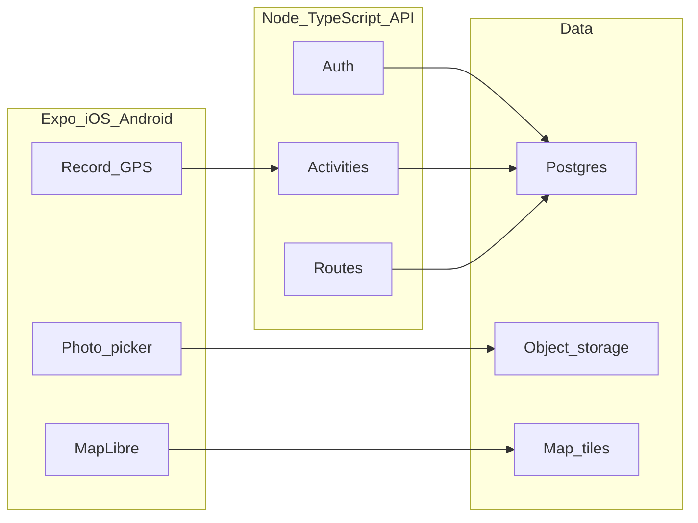

# Trail — Product Requirements Document

**Working name:** Trail  
**Status:** Draft v1.0  
**Date:** 2026-08-21  
**Platform:** Mobile-first (iOS + Android via Expo)  
**Stack:** Expo (React Native) + Node/TypeScript API + Postgres  

This document is the source of truth for v1. It is not a Strava clone by name. Do not ship, market, or trademark the product as “Strava.” Trail is an independent fitness recording and review product.

---

## 1. Vision and problem

### 1.1 Vision

Trail is a production mobile app for people who want a reliable record of outdoor activity: start a run or ride, keep GPS alive in the background, then review the map, splits, elevation, photos, and weekly volume.

v1 is a **personal training log**, not a social network. The product must feel complete for a solo athlete: record, save, review, plan a route, attach photos, and see progress.

### 1.2 Problem

Popular fitness apps mix recording with a heavy social feed. Many athletes want:

- GPS recording that survives lock screen, calls, and brief app switches
- A clear activity page (map, stats, splits, elevation, photos)
- Saved routes they can reuse
- Simple training volume (week / year / calendar)

without following people, kudos, or clubs in the first release.

### 1.3 Who it is for

Solo runners, cyclists, walkers, and hikers who will use the phone as the primary GPS device. Not coaches, teams, or wearable-first users in v1.

### 1.4 Positioning

| Trail v1 is | Trail v1 is not |
|---|---|
| A personal GPS log | A social network |
| Phone-first recording | A Garmin / Apple Watch companion |
| Map + stats + routes | Segments, clubs, or challenges |
| Free to use | A monetized subscription (later) |

---

## 2. Goals and non-goals

### 2.1 v1 goals

1. A new user can create an account and record a complete outdoor activity on iOS and Android.
2. Recording continues with the screen off and the app backgrounded (within OS rules).
3. After save, the user can open a full activity page: map polyline, headline stats, splits, elevation, photos.
4. The user can build and save a route, then start recording from it.
5. The user can see weekly and yearly totals plus a training calendar.
6. The app is shippable to TestFlight / Play internal testing with production-shaped auth, API, and data storage.

### 2.2 Non-goals (v1)

- Social feed, follow graph, kudos, comments
- GPX / FIT file upload or import from other apps
- Segments and leaderboards
- Clubs, group events, challenges
- Privacy zones (home/work hiding)
- Garmin, Apple Health, Strava, or other wearable/cloud sync
- Web app, tablet-optimized UI, or Wear OS / watch app
- Live segments, beacons, or safety / SOS
- Nutrition, sleep, or heart-rate training zones as a product surface (HR may be captured later)

### 2.3 Success for this PRD

v1 is done when the journeys in section 4 pass the acceptance criteria in section 5 on real devices, not only simulators, including a backgrounded recording of at least 20 minutes.

---

## 3. Assumptions

These are changeable. Call them out in implementation if they break.

| ID | Assumption |
|---|---|
| A1 | Sports in v1: **run, ride, walk, hike** |
| A2 | Auth: email/password + **Sign in with Apple** + Google; API uses JWT access + refresh tokens |
| A3 | Maps: **MapLibre** on device; **MapTiler** for development; **Protomaps** (self-hosted PMTiles) as the scale path |
| A4 | Units: metric and imperial; user preference stored on the profile |
| A5 | Language: **English** only in v1 |
| A6 | v1 is **free**; no paywall, ads, or IAP |
| A7 | Route builder is tap-to-place waypoints + optional snap-to-roads, not a full desktop route studio |
| A8 | Target: consumer App Store / Play Store, not enterprise MDM |
| A9 | Primary region: worldwide OSM coverage; no country lock in v1 |
| A10 | Timezones: store instants in UTC; display in the device timezone |

---

## 4. Personas and jobs-to-be-done

### 4.1 Maya — frequent runner

Runs 3–5 times per week, mostly neighborhood loops. Wants to press Start, pocket the phone, and trust the distance. Afterward she checks pace splits and weekly mileage.

**Jobs:** record without babysitting GPS; see if this week is on target; attach a photo of a route or finish.

### 4.2 Jordan — cyclist

Rides longer efforts (60–120 min). Needs background GPS, elevation, and a saved route for a regular loop. Reviews the map to confirm the path and climb.

**Jobs:** keep recording with the screen off; reuse a saved route; see yearly distance.

### 4.3 Priya — walker / hiker (weekend)

Records less often, cares about the map story and photos more than splits. May lose signal on trails.

**Jobs:** record offline and sync later; drop photos on the activity; see the path on a topographic-friendly map.

### 4.4 Jobs-to-be-done (v1)

| Job | Outcome |
|---|---|
| Record an activity | Accurate enough GPS track + stats, saved to the account |
| Review an activity | Map, numbers, splits, elevation, photos in one place |
| Plan a route | Named, saved polyline they can follow later |
| Track volume | Week / year totals and a calendar of days trained |
| Recover from interruption | App crash or OS kill does not wipe an in-progress recording |

---

## 5. User journeys

### 5.1 First-run: signup to first saved activity

1. Install Trail. See a short value screen (record, map, stats) and **Create account** / **Sign in**.
2. Sign up with Apple, Google, or email. Grant location permission when prompted (before first record, not before signup).
3. Land on the Record tab with sport selector (default: run) and a live map at current location.
4. Tap **Start**. GPS lock indicator turns good (or warns if poor). Timer and distance begin.
5. Lock the phone. Walk/run for several minutes. Reopen the app: recording is still running.
6. Tap **Stop** → confirm **Save**. Optional title, photos, and visibility of notes.
7. Activity detail opens: polyline on the map, distance, time, pace, elevation, splits.
8. Stats tab shows today’s activity on the calendar and updated weekly total.

**Happy-path SLA:** a motivated user completes this in under 10 minutes of wall time (excluding the activity itself).

### 5.2 Record on a saved route

1. Open Routes → pick a saved route → **Record this route**.
2. Record tab opens with sport prefilled, route drawn on the map, and Start armed.
3. User records as in 5.1. Saved activity stores `route_id` when started from a route.

### 5.3 Build a route, then use it

1. Routes → **New route**.
2. Tap the map to drop waypoints. Optional **Snap to roads**. See distance and elevation estimate.
3. Name and save. Route appears in the list and can start a recording.

### 5.4 Attach photos after save

1. Open an activity → **Add photos**. Pick from library and/or camera (OS permission).
2. Photos appear in a gallery on the activity and as optional map markers if a capture location exists.

### 5.5 Failure / recovery journeys (required)

- Mid-recording app crash: on relaunch, user is offered **Resume recording** with buffered points intact.
- No network during recording: points stay on device; save queues until upload succeeds.
- Location denied: Record tab explains why location is required and links to system settings. Start is disabled.
- Poor GPS: user can still start, with a persistent warning and accuracy shown.

---

## 6. Functional requirements

Priority: **MUST** = v1 ship blocker. **SHOULD** = v1 unless cut with a written exception. **COULD** = nice if cheap; otherwise v1.1+.

### 6.1 Accounts, profile, and units

| ID | Priority | Requirement | Acceptance criteria |
|---|---|---|---|
| AUTH-1 | MUST | Email + password sign up / sign in | Valid email, password ≥ 8 chars, hashed server-side (Argon2id or bcrypt). Duplicate email rejected. |
| AUTH-2 | MUST | Sign in with Apple | Works on iOS. Required if any third-party login is offered on iOS. Hide-my-email supported. |
| AUTH-3 | MUST | Sign in with Google | Works on iOS and Android. Same user if email already exists (account linking rules documented). |
| AUTH-4 | MUST | Session tokens | Short-lived access JWT + rotating refresh token stored in secure storage (Keychain / EncryptedSharedPreferences). Logout revokes refresh token. |
| AUTH-5 | MUST | Sign out | Clears tokens and unsynced **draft** policy: in-progress recording is not discarded without confirm. |
| AUTH-6 | SHOULD | Password reset | Email magic link or token; expires; cannot enumerate accounts in error text. |
| PROF-1 | MUST | Profile | Display name, optional avatar, sport defaults, units (km/mi, °C/°F not required v1). |
| PROF-2 | MUST | Units | Distance, pace, and elevation follow profile units everywhere in the app. |
| PROF-3 | SHOULD | Delete account | Confirms, deletes user row and cascaded data, deletes photos from object storage, returns success. |

### 6.2 Live GPS recording

| ID | Priority | Requirement | Acceptance criteria |
|---|---|---|---|
| REC-1 | MUST | Start / pause / resume / stop | Pause freezes timer and does not append points. Resume continues same activity. Stop ends session and offers Save or Discard. |
| REC-2 | MUST | Sport selection before start | Run, ride, walk, hike. Can change sport only before Start (not mid-activity in v1). |
| REC-3 | MUST | Foreground GPS | 1 Hz target while moving; filter points with poor accuracy (see NFR-GPS). |
| REC-4 | MUST | Background GPS | iOS: background location mode + purpose strings. Android: foreground service with persistent notification showing elapsed time and distance. Screen off for 20+ minutes does not stop the track on a mid-range device with location allowed. |
| REC-5 | MUST | Live HUD | Elapsed time, distance, current pace (or speed for ride), GPS accuracy state. |
| REC-6 | MUST | Live map | User location + in-progress polyline. Follow-user toggle. |
| REC-7 | MUST | Crash-safe buffer | Points written to local durable storage at least every 5 seconds or every N points. Relaunch restores in-progress session. |
| REC-8 | MUST | Offline recording | Full record/save flow without network. Upload when connectivity returns. User sees “Waiting to upload.” |
| REC-9 | MUST | Discard | Discard requires confirm. Deletes local buffer. Nothing is sent to the API. |
| REC-10 | SHOULD | Auto-lock hint | After start, prompt to keep battery optimization off on Android (OEM-specific, best-effort). |
| REC-11 | COULD | Auto-pause | Stop appending when speed ≈ 0 for a threshold. Not a v1 MUST. |
| REC-12 | COULD | Audio cues | Split announcements. Not a v1 MUST. |
| REC-13 | MUST | Permission UX | First Start requests When In Use, then Always / background as required. Denial is explained, not a silent failure. |
| REC-14 | MUST | Minimum activity | Save allowed only if duration ≥ 30s **or** distance ≥ 50 m (whichever policy is implemented, document it). Prevents empty accidental saves. |

**Recording state machine**

```
Idle → Starting → Recording ⇄ Paused → Stopping → Saving → Idle
                              ↘ Discard → Idle
Recording / Paused persist across process death via local session file.
```

### 6.3 Activity save and activity detail

| ID | Priority | Requirement | Acceptance criteria |
|---|---|---|---|
| ACT-1 | MUST | Persist activity | Server stores sport, start/end UTC, stats, encoded track, splits, elevation series, optional `route_id`. |
| ACT-2 | MUST | Derived stats | Distance, moving time, elapsed time, avg pace or speed, elevation gain (and loss SHOULD). |
| ACT-3 | MUST | Encoded polyline | Google-encoded polyline or equivalent compact geometry for the map. Raw points may be downsampled for storage; algorithm documented. |
| ACT-4 | MUST | Splits | Automatic splits every 1 km or 1 mi matching user units. Split time and pace. Last partial split shown. |
| ACT-5 | MUST | Elevation | Series for a chart. Prefer DEM/terrain API when GPS altitude is noisy; fall back to GPS altitude with smoothing. |
| ACT-6 | MUST | Activity list | Reverse-chronological list on Activity tab: sport, date, distance, time, thumbnail map optional (COULD). |
| ACT-7 | MUST | Activity detail screen | Map with full polyline, fit-to-bounds, headline stats, splits list, elevation chart, photos, title/notes. |
| ACT-8 | MUST | Edit after save | Title and notes. Sport change SHOULD. Cannot edit the GPS track in v1. |
| ACT-9 | MUST | Delete activity | Confirm; deletes DB row and photos. |
| ACT-10 | SHOULD | Share image | Static map + stats card as an image to the OS share sheet (no social network inside the app). |

**Headline stats (detail)**

- Distance  
- Moving time and elapsed time  
- Average pace (run/walk/hike) or average speed (ride)  
- Elevation gain  
- Calories **COULD** (estimate only; label as estimate if shown)

### 6.4 Photos

| ID | Priority | Requirement | Acceptance criteria |
|---|---|---|---|
| PHO-1 | MUST | Attach from library | Multiple images per activity; JPEG/HEIC/WebP normalized server-side; max count 10 per activity in v1; max size documented (e.g. 10 MB each before compress). |
| PHO-2 | SHOULD | Camera capture | From activity detail and from post-save sheet. |
| PHO-3 | MUST | Storage | Object storage (S3-compatible). App uses short-lived signed URLs. Photos are not public-listable. |
| PHO-4 | SHOULD | Map markers | If EXIF/GPS or “taken during activity” timestamp maps to the track, show a pin. Otherwise gallery only. |
| PHO-5 | MUST | Delete photo | Removes blob and DB row. |
| PHO-6 | MUST | Upload retry | Failed photo upload retries; activity can exist with photos still pending. |

### 6.5 Route builder and saved routes

| ID | Priority | Requirement | Acceptance criteria |
|---|---|---|---|
| RTE-1 | MUST | Create route | Tap to add waypoints in order. Undo last point. Clear. |
| RTE-2 | SHOULD | Snap to roads | Toggle uses a routing API (Valhalla / commercial equivalent). If snap fails, keep unsapped line and show error. |
| RTE-3 | MUST | Route stats | Distance of the line; elevation gain SHOULD if DEM available. |
| RTE-4 | MUST | Save / name / list / delete | Named routes owned by the user. Empty name rejected. |
| RTE-5 | MUST | View route | Map + stats + **Record this route**. |
| RTE-6 | SHOULD | Edit waypoints | Reopen and adjust before save; post-save edit COULD. |
| RTE-7 | COULD | Reverse route | One tap reverse of waypoint order. |
| RTE-8 | MUST | Start recording from route | Prefills map overlay; does not auto-start GPS until user taps Start. |

v1 route builder is **not** required to support loop detection, surface type, or popularity heat.

### 6.6 Training stats

| ID | Priority | Requirement | Acceptance criteria |
|---|---|---|---|
| STA-1 | MUST | Week totals | Distance, moving time, activity count, elevation gain for the current local week. Sport filter: all + each sport. |
| STA-2 | MUST | Year totals | Same metrics for current calendar year. |
| STA-3 | MUST | Calendar | Month grid; days with activities marked; tap day → list those activities. |
| STA-4 | SHOULD | Previous week / year | Simple back/forward on week and year. |
| STA-5 | COULD | Streak | Consecutive days with ≥1 activity. Not a ship blocker. |

Stats are computed from **saved, uploaded** activities. Local unsynced recordings are excluded from totals until save+sync succeeds, or included locally with a “not synced” badge (pick one; default: exclude until synced, show banner if a local draft exists).

### 6.7 App shell and settings

| ID | Priority | Requirement | Acceptance criteria |
|---|---|---|---|
| NAV-1 | MUST | Tab bar | **Record** · **Activity** · **Routes** · **You** |
| SET-1 | MUST | Settings on You | Units, linked accounts (Apple/Google status), sign out, delete account, legal links, map attribution. |
| SET-2 | MUST | OSM / provider attribution | Visible on every map surface per OSM and tile-provider terms. |
| SET-3 | SHOULD | Diagnostic | App version, a way to export last recording debug log for support (no PII dump by default). |

---

## 7. Non-functional requirements

### 7.1 GPS quality (NFR-GPS)

- Prefer locations with horizontal accuracy ≤ 20 m when possible.
- Drop or down-weight points with accuracy > 50 m unless they are the only fix.
- Discard impossible jumps (e.g. > 50 m/s for run/walk/hike, > 50 m/s still generous for ride — use sport-specific caps: run/walk/hike 12 m/s sustained unless GPS blip; ride 30 m/s).
- Smooth elevation; do not sum raw GPS altitude noise as gain.
- Distance is the sum of filtered consecutive points, not a geodesic of start–end.

### 7.2 Battery and performance

- Recording should not drain an unreasonable amount vs comparable apps on a 60-minute run (document a device baseline during QA).
- Live map may reduce frame rate when backgrounded; GPS sampling continues.
- Activity list of 200 items scrolls without hitching; polyline of a 5-hour ride renders on a mid-range phone (downsample for display if needed, keep full series for stats).

### 7.3 Offline

- Record, pause, stop, and local save work offline.
- Map tiles: last-viewed region may be cached by the map SDK; **offline map download packs are out of v1**.
- Route builder SHOULD warn if snap-to-roads requires network and the device is offline.

### 7.4 Reliability

- Crash-free sessions ≥ 99.5% in beta (excluding known OS kills of background tasks).
- No lost in-progress recording if the process is killed and the user reopens within 24 hours.
- Idempotent activity upload (client-generated UUID) so retries do not duplicate activities.

### 7.5 Security

- HTTPS only.
- Passwords never logged.
- Photos and GPS tracks are private to the owner. No public activity URLs in v1.
- Rate-limit auth endpoints.
- Signed upload URLs expire (e.g. 15 minutes).

### 7.6 Accessibility

- Dynamic type for HUD numbers and lists (scale reasonably; map HUD may cap size).
- VoiceOver / TalkBack labels on Start, Pause, Stop, tabs.
- Color is not the only GPS-accuracy signal (icon + text).

### 7.7 Localization and time

- English UI only.
- Locale-aware number and date formatting.
- Monday vs Sunday week start: follow locale; document.

### 7.8 Legal / attribution

- OpenStreetMap copyright and tile provider attribution on maps.
- Privacy policy and terms URLs in the app (can be static pages).
- No use of OSM Foundation public tile servers in production or TestFlight.

---

## 8. Information architecture

### 8.1 Tab bar

| Tab | Primary purpose |
|---|---|
| Record | Map, sport, Start/Pause/Stop, live stats |
| Activity | List of saved activities → detail |
| Routes | Saved routes, create/edit, record from route |
| You | Totals, calendar, profile, settings |

### 8.2 Screens (v1)

**Auth**

- Welcome  
- Sign in  
- Sign up (email)  
- Forgot password  

**Record**

- Record (idle / recording / paused)  
- Save sheet (title, notes, photos, save/discard)  
- Resume-recording prompt (after crash)

**Activity**

- Activity list  
- Activity detail (map, stats, splits, elevation, photos)  
- Edit title/notes  
- Photo viewer  

**Routes**

- Route list  
- Route builder  
- Route detail  

**You**

- Stats home (week / year / calendar)  
- Profile  
- Settings  
- Legal (in-app WebView or OS browser)

### 8.3 Empty states

- No activities: CTA to Record tab  
- No routes: CTA to create route  
- Location off: explainer + Settings deep link  

---

## 9. Data model

Logical entities. Physical types (UUID, timestamptz) are implementation defaults.

### 9.1 `users`

| Field | Notes |
|---|---|
| id | UUID |
| email | Unique, nullable if Apple hide-my-email uses private relay only — still store a stable identifier |
| password_hash | Nullable for SSO-only |
| display_name | |
| avatar_url | Nullable |
| units | `metric` \| `imperial` |
| default_sport | |
| created_at / updated_at | UTC |

### 9.2 `auth_identities`

Provider (`password`, `apple`, `google`), provider subject, user_id. Unique (provider, subject).

### 9.3 `refresh_tokens`

Hashed token, user_id, expires_at, revoked_at, device hint.

### 9.4 `activities`

| Field | Notes |
|---|---|
| id | UUID, **also sent as client_id** for idempotency |
| user_id | |
| sport | `run` \| `ride` \| `walk` \| `hike` |
| title | Optional; default generated e.g. “Morning Run” |
| notes | Optional |
| started_at / ended_at | UTC |
| distance_m | Integer or numeric |
| moving_time_s / elapsed_time_s | |
| elevation_gain_m / elevation_loss_m | |
| avg_pace or derived | Store canonical distance + time; derive pace in API/UI |
| polyline | Encoded overview |
| elevation_series | JSON array of `{t, ele}` or parallel arrays |
| splits | JSON array of `{idx, distance_m, time_s}` |
| route_id | Nullable FK |
| sync_status | `pending` is client-only; server rows are committed |
| created_at | |

### 9.5 Track storage

Two acceptable designs; pick one in implementation and stick to it:

1. **Overview polyline + downsampled points table** (`activity_points`: activity_id, seq, lat, lon, ele, recorded_at, accuracy_m)  
2. **Compressed blob** (encoded points) plus polyline for maps  

v1 SHOULD keep enough points to recompute splits and elevation. Do not store unfiltered 1 Hz forever without a retention/downsample policy (e.g. keep 1 Hz for 7 days, then downsample — **COULD**; v1 may keep full filtered stream).

### 9.6 `routes`

| Field | Notes |
|---|---|
| id | UUID |
| user_id | |
| name | Required |
| sport_hint | Optional |
| waypoints | JSON `[ {lat, lon} ]` |
| polyline | After snap or raw |
| distance_m | |
| elevation_gain_m | Nullable |
| created_at / updated_at | |

### 9.7 `activity_photos`

| Field | Notes |
|---|---|
| id | UUID |
| activity_id | |
| object_key | |
| width / height | |
| lat / lon | Nullable |
| captured_at | Nullable |
| sort_order | |

### 9.8 Stats

No separate OLAP store in v1. **Query activities** with indexes on `(user_id, started_at)`. Add a rollup table later if lists slow down.

---

## 10. Architecture

### 10.1 Overview



### 10.2 Client (Expo)

- Expo (React Native) for iOS and Android  
- Navigation: tab + stack  
- Maps: MapLibre React Native  
- Location: `expo-location` + background task (`expo-task-manager`) as required by OS  
- Secure storage for tokens  
- Local recording session: SQLite or file-backed JSON/binary buffer  
- Image picker: `expo-image-picker`  

**Background constraints**

- **iOS:** `UIBackgroundModes` location; Info.plist usage descriptions; Always location if required for lock-screen recording. App Store review must match actual use (fitness tracking).  
- **Android 8+:** foreground service type `location`; persistent notification; request notifications permission on Android 13+. Document OEM battery exemptions as a help article, not as a silent requirement.

### 10.3 API (Node + TypeScript)

REST (JSON) is the v1 default. Version prefix `/v1`.

Suggested resource groups:

- `POST /v1/auth/register` `POST /v1/auth/login` `POST /v1/auth/refresh` `POST /v1/auth/logout`  
- `POST /v1/auth/apple` `POST /v1/auth/google`  
- `GET/PATCH /v1/me` `DELETE /v1/me`  
- `GET/POST /v1/activities` `GET/PATCH/DELETE /v1/activities/:id`  
- `POST /v1/activities/:id/photos/signed-url`  
- `GET/POST /v1/routes` `GET/PATCH/DELETE /v1/routes/:id`  

Errors: consistent `{ error: { code, message } }` and HTTP status codes.

### 10.4 Data stores

- **Postgres** — source of truth  
- **Object storage** — photos (Cloudflare R2 or S3)  
- **Map tiles** — MapTiler key in development; production plan is self-hosted Protomaps or a paid tile plan. Never OSM.org tiles.

### 10.5 Elevation and routing

- Elevation: MapTiler Terrain / Open-Meteo / other DEM; batch along the polyline after save if live DEM is too heavy.  
- Snap-to-roads: self-hosted Valhalla or a commercial routing API with a production license. Free OpenRouteService is **non-commercial**; do not use it as the production default for a real product.

---

## 11. Maps and geo strategy

| Layer | v1 choice | Notes |
|---|---|---|
| Render library | MapLibre GL (native) | No Mapbox GL JS license |
| Dev tiles | MapTiler free/R&D | Non-commercial limits; OK for local/dev |
| Prod tiles | Protomaps PMTiles or paid MapTiler/Stadia | Required before public launch |
| Geocoding | Optional SHOULD | Search in route builder; can ship without |
| Routing / snap | SHOULD | Separate from tiles |
| Activity geometry | Client-collected GPS | Not from the map vendor |

**Display rules**

- Fit polyline with padding.  
- Recording mode: follow puck; user can pan (breaks follow until re-enabled).  
- Attribution always visible (not hidden under the HUD).

---

## 12. Permissions and compliance

### 12.1 OS permissions

| Permission | When to ask | If denied |
|---|---|---|
| Location when in use | Before first Start | Cannot record; explainer |
| Location always / background | After user starts or from a pre-record education screen | Recording may stop when backgrounded; warn |
| Notifications (Android 13+) | Before first background record | Foreground service notification still required; explain |
| Photo library / camera | When adding photos | Gallery attach disabled; activity still savable |

### 12.2 Purpose strings (iOS)

- When in use: “Trail uses your location to record the path of your run, ride, walk, or hike.”  
- Always: “Trail needs background location so your activity continues with the screen locked.”  
- Camera / photos: activity photos only.

### 12.3 Privacy policy (must exist before store listing)

State that we collect: account identifiers, GPS tracks, photos the user attaches, device-ish metadata for auth. Tracks are private. Retention: until account or activity deletion. No selling of location data.

### 12.4 App Store / Play

- Fitness + location background justification  
- Apple Sign In if Google is offered on iOS  
- Data safety / privacy nutrition labels aligned with actual collection  

---

## 13. Analytics and success metrics

No dark patterns. Analytics MUST be opt-in or limited to non-PII events in v1; document the choice in implementation.

### 13.1 Product metrics (v1)

| Metric | Target (beta → public) |
|---|---|
| Signup → first **saved** activity within 24h | ≥ 40% of signups who grant location |
| Recording completion (Start → Save, not Discard) | ≥ 70% of sessions ≥ 2 minutes |
| Upload success within 1h of Save | ≥ 99% given any network later |
| Crash-free sessions | ≥ 99.5% |
| Background record success (QA script, 20 min lock screen) | Pass on current iOS and Android target devices |

### 13.2 Events (if instrumented)

`auth_success`, `record_start`, `record_save`, `record_discard`, `record_resume_after_crash`, `photo_upload_ok`, `route_save`, `permission_location_denied`

Do not send raw GPS in analytics.

---

## 14. Phased roadmap

### 14.1 v1 — this PRD (ship)

Auth (email, Apple, Google), profile, units, live GPS record with background + crash buffer, activity list/detail, splits, elevation, photos, route builder + saved routes, week/year stats + calendar.

### 14.2 v1.1 — hardening

- Auto-pause  
- GPX **export** (still no import)  
- Share card polish  
- Offline map cache for a chosen region (if feasible)  
- Password reset if not already in v1  
- Account deletion polish and data export  

### 14.3 v2 — social (deferred)

Follow, activity feed, kudos, comments, activity visibility (followers/everyone), optional privacy zones.

### 14.4 v3 — graph and hardware (deferred)

Segments + leaderboards, clubs/challenges, GPX/FIT **import**, Garmin / Apple Health / Health Connect, watch app.

### 14.5 Later / optional

Web dashboard, subscriptions, coaching, training plans, live tracking for safety.

---

## 15. Risks and mitigations

| Risk | Impact | Mitigation |
|---|---|---|
| iOS/Android kill background GPS | Lost or short activities; 1-star reviews | Foreground service, crash buffer, QA on OEM devices, in-app battery guidance |
| App Store rejection of Always location | Blocked release | Clear purpose strings, record-only use, review notes, education screen before Always |
| Battery drain | Uninstalls | Adaptive GPS, pause map renderer in background, measure on device |
| Map tile cost or ToS | Surprise bills or blocked tiles | MapTiler only for R&D; Protomaps or paid plan before launch |
| Routing API ToS (ORS free = non-commercial) | Legal risk | Production Valhalla or paid routing |
| Duplicate uploads | Inflated stats | Client UUID idempotency |
| Noisy GPS elevation | Fake “Alps” on flat runs | DEM-based gain; show GPS altitude only if labeled |
| SSO account collision | Locked out users | Document linking policy; support email |
| Scope creep into social | Delayed v1 | v2 is a separate PRD |

---

## 16. Target devices and QA

### 16.1 Support

- **iOS:** current major version and previous major  
- **Android:** API 26+ (or Expo default min), 64-bit  

### 16.2 v1 QA scripts (minimum)

1. Sign up Apple (iOS) and Google (both); email sign up; refresh token after 24h cold start.  
2. 20-minute walk, screen locked, then save; compare distance to a known loop (~tolerance 5–8% on urban canyon, tighter in open sky).  
3. Airplane mode record → reconnect → activity appears once.  
4. Kill app mid-record → relaunch → resume → save.  
5. Attach 3 photos; delete one; confirm blob gone.  
6. Build a 5-waypoint route, snap on/off, record from route.  
7. Deny location; confirm Start blocked + settings link.  
8. Stats: two sports in one week; filters and calendar.

---

## 17. Open questions

Resolve before or during implementation; update this PRD when decided.

| ID | Question | Default if unanswered |
|---|---|---|
| Q1 | Final product name and brand? | Keep **Trail** |
| Q2 | Is snap-to-roads required for v1 launch or can it ship as SHOULD later? | SHOULD: ship tap-to-draw without snap if routing is not licensed yet |
| Q3 | Target countries / export compliance? | Worldwide, English only |
| Q4 | Calories on activity detail? | Hide in v1 |
| Q5 | Week start Monday vs Sunday? | Follow device locale |
| Q6 | Analytics vendor vs none in v1? | None or first-party counts only |
| Q7 | Photo EXIF stripping for privacy? | Strip EXIF except optional lat/lon we store ourselves |
| Q8 | Max activity duration? | 12 hours then auto-stop with save prompt |
| Q9 | Production tile provider before first public store release? | Must be decided; blocker for public launch, not for internal dev |

---

## 18. Glossary

| Term | Meaning |
|---|---|
| Activity | One saved recording (run, ride, walk, or hike) |
| Moving time | Elapsed time minus paused time (and auto-pause if added later) |
| Split | Stats for one km or one mile of the activity |
| Route | A planned polyline the user saved; not an activity |
| Puck | User location marker on the map |
| DEM | Digital elevation model used instead of raw GPS altitude |

---

## 19. Document control

| Version | Date | Notes |
|---|---|---|
| 1.0 | 2026-08-21 | Initial PRD from scoped decisions: production mobile-first app; v1 = auth, GPS record, activity detail, routes, photos, stats. Social, segments, clubs, wearables, and file import are out of v1. |

**Implementation rule:** do not start the Expo or API apps from this file until explicitly asked. This PRD is the spec, not the codebase.
